> 当前完整源码、海报与答辩材料已迁移至 **[简行新公开仓库](https://github.com/xqcd77/jianxing)**。本页以下内容保留为早期界面展示，评测数字请以新仓库2026-10-28冻结记录为准。

# 简行 · Jianxing

**一句话提出需求，每一步清楚办妥。**

个人银行多智能体工作台 · 需求拆解 · 证据研究 · 安全办理

`OpenAI Agents SDK` · `ChromaDB` · `LangGraph` · `FastAPI`

[产品展示](#产品展示) · [六类业务](#六类业务) · [系统架构](#系统架构) · [验证记录](#验证记录)

简行是个人银行业务的 AI Agent 原型。用户可以在一句话中提出转账、账单、理财等多个目标；系统分别保留办理进度、缺少的条件和研究结果，再通过本人确认、强验证与银行规则完成操作。

> 合成银行沙箱：账户、资金、产品和订单均为演示数据，不连接真实银行，不产生真实扣款。

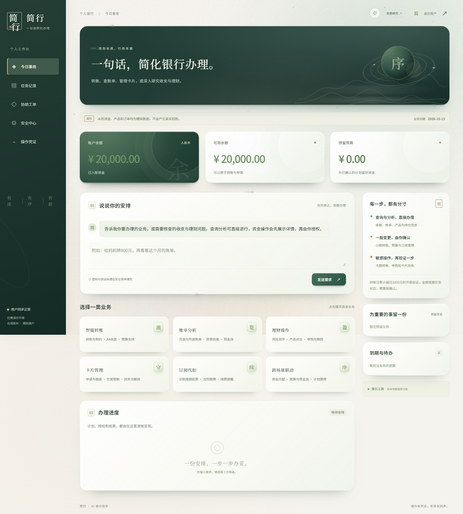

## 这一版更新了什么

| 体验 | 具体变化 |
| --- | --- |
| 多项需求分别推进 | 转账、研究与待补条件分别留在目标清单；独立任务不因另一项缺条件而消失 |
| 多轮任务继续办理 | 补充产品、金额或测评后衔接原任务，已完成回执保留，避免重复办理 |
| 前置条件直接进入 | 需要风险测评或大额验证时打开对应办理界面，完成测评后返回原计划 |
| 过程可见、任务可停 | 展示实际执行阶段与耗时；完成后收起步骤并逐字答复，支持停止、刷新恢复及断线重连 |
| 研究报告重新分层 | 结论与关键数字 → 核查框架与依据 → 产品条件与排除理由，原始证据可回读 |
| 视觉与排版升级 | 动态登录、立体玉色头图、柔光玻璃、星云边缘与受控粒子；本地中文字体、手机适配和减少动态效果 |

## 产品展示

14 张实际界面截图，按使用流程与功能分组。点击图片可查看原图。业务使用真实本地沙箱 API，模型使用可复现的规则演示模式；ETF 外部资料使用固定测试夹具，不表示实时行情或真实模型推荐。动态效果在静态截图中展示其某一帧。

### 进入工作台

### 提出需求，查看每项目标

| 03 · 执行步骤与停止入口 | 04 · 复合需求与目标进度 |
| --- | --- |
| 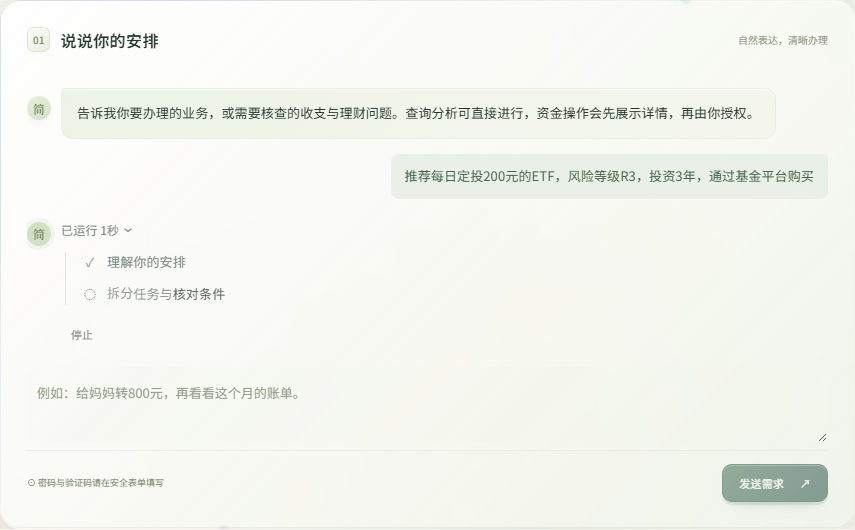 |  |
| 公开执行阶段持续更新；完成后收起步骤。 | “妈妈400元、小王1500元、剩余20%理财”分别跟进。 |

### 核对条件，由本人授权

| 05 · 大额转账验证 | 06 · 风险测评直接进入 |
| --- | --- |
| 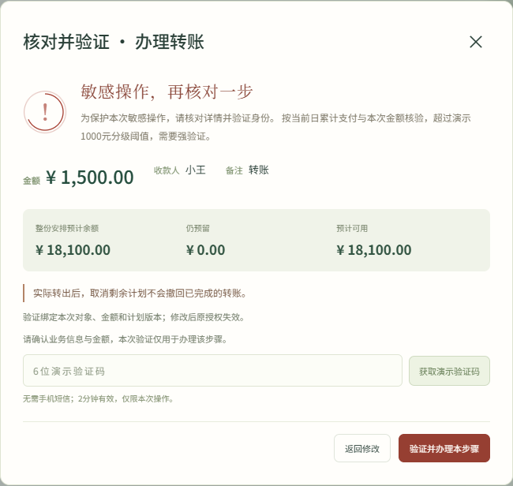 | 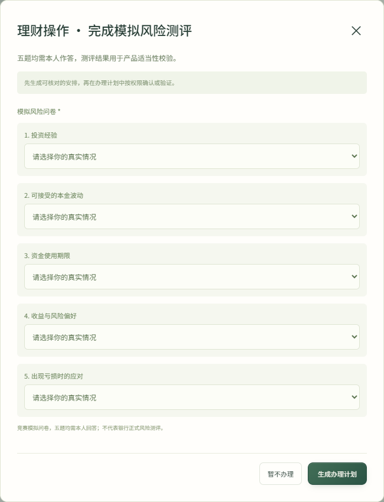 |
| 验证绑定本次对象、金额与计划版本。 | 选品不代表申购授权；测评完成后可返回原计划。 |

### 先研究，再选择

报告将关键数字、分析框架和产品对比依次展开；每个产品保留条件说明和原始依据入口。

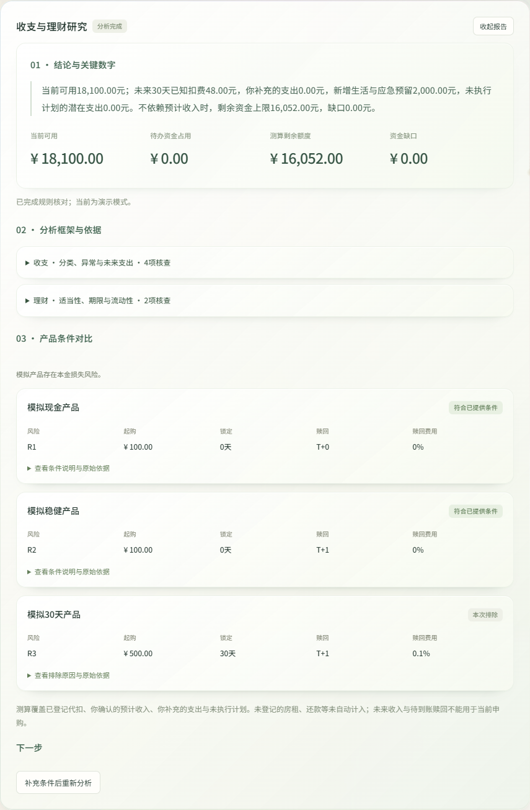

### 日常业务与结果回执

| 08 · 账单分析 | 09 · 理财产品对比 |
| --- | --- |
| 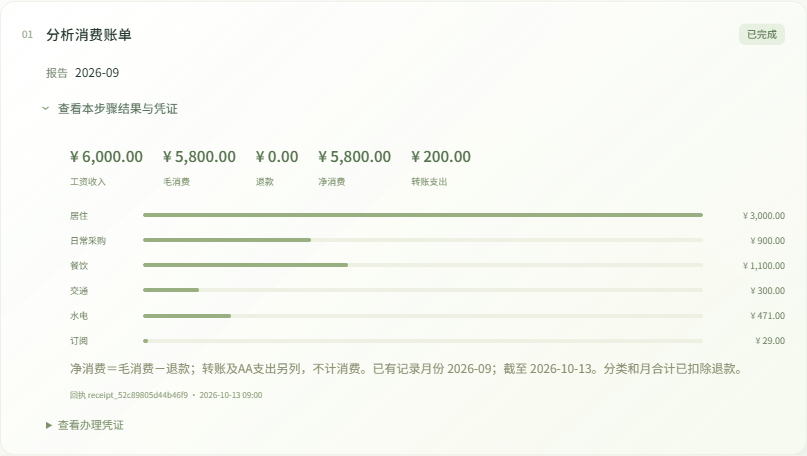 |  |
| 转账单列，净消费按毛消费减退款计算。 | 从条款与当前条件比较产品，不承诺收益。 |

| 10 · 卡片管理 | 11 · 订阅与银行代扣 |
| --- | --- |
| 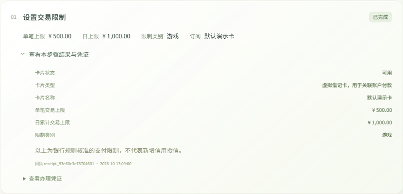 | 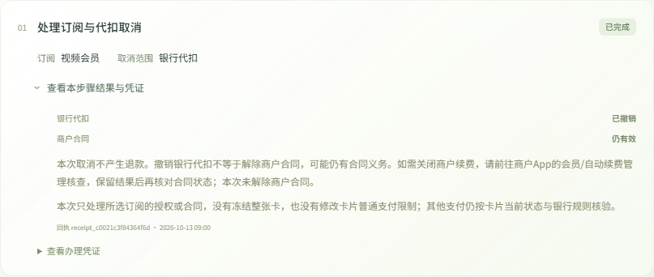 |
| 展示银行核准的支付限制与回执。 | 停止银行代扣、解除合同和退款分别处理。 |

### 跨业务安排与公开资料

| 12 · 资金影响与任务依赖 | 13 · ETF 资料与条件核对 |
| --- | --- |
| 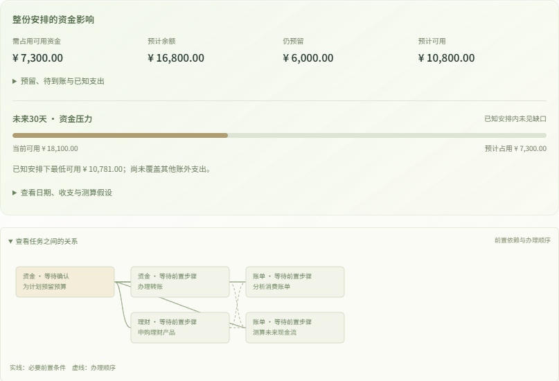 |  |
| 提前核对预留、余额、可用资金与办理顺序。 | 资料查询保留来源；未接入证券购买及自动定投。 |

### 手机端

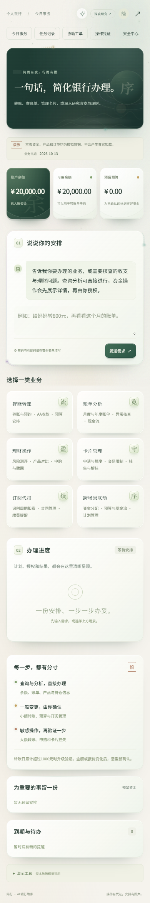

## 六类业务

| 场景 | 可体验的功能 | 业务边界 |
| --- | --- | --- |
| 智能转账 | 联系人匹配、转账、预约、AA 收款、预算预留 | 收款人明确；资金操作需授权；AA 参与者分别确认 |
| 账单分析 | 月报、年报、退款口径、异常线索、现金流压力 | 空记录不等于零消费；异常线索不等于欺诈结论 |
| 理财操作 | 风险测评、比较、持仓、申购、赎回、延迟结算 | 核验测评、起购、锁定与到账；不保证本金收益 |
| 卡片管理 | 申请、支付限额、类别限制、挂失与解挂 | 卡片共享关联账户；支付限额不等于信用授信 |
| 订阅代扣 | 周期消费候选、合同查询、提醒、停扣与解约 | 候选不等于合同；停扣不等于解约或退款 |
| 跨场景联动 | 预算、转账与理财组合、依赖计划、综合研究 | 先核对整单资金影响；研究结论不代替交易授权 |

## 系统架构

**1 个 Supervisor ＋ 4 个专业子 Agent**：账单研究、理财研究、业务办理、独立核验。六类业务服务是确定性规则组件。

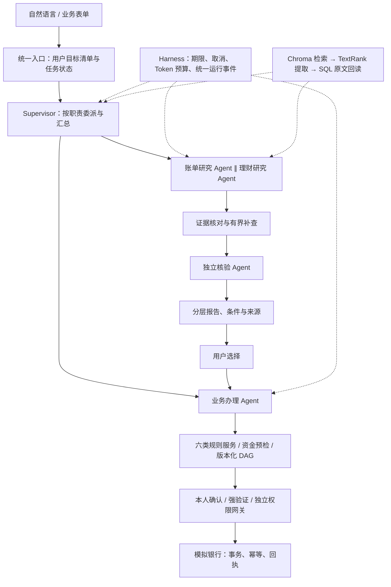

| 组件 | 职责 |
| --- | --- |
| OpenAI Agents SDK | 通过统一适配器执行角色的单轮结构化提案，沿用配置的业务模型 |
| LangGraph | 分派、核验、有界反馈、检查点与暂停恢复 |
| Harness | 统一调用期限、取消、完整请求 Token 预算及运行事件 |
| ChromaDB | 保存派生向量与权限元数据，检索后再次核对授权来源 |
| SQLAlchemy / SQLite | 保存正式账本、任务状态、授权、回执和可回读原文 |
| 业务网关 | 执行时复算余额、权限与适当性，负责幂等提交和未知结果核实 |

金额、日期、对象、否定要求与版本作为受保护字段保留。当前任务状态直接读取持久记录；历史记忆经权限过滤、语义检索、原句提取后，可按来源 ID 回读 SQL 原文。Chroma 不承担资金账本。

## 验证记录

| 验证 | 结果与口径 |
| --- | --- |
| 本次发布相关回归 | 147 项通过，覆盖 SDK、Chroma、Token、记忆冲突、多目标与后台请求等模块 |
| 本次前端与制品检查 | Ruff、两套 TypeScript 检查通过；构建 wheel 并确认本地字体和许可证随包分发 |
| 本次截图验收 | 14 个实际界面，1440px 桌面与390px 手机，无水平溢出及浏览器脚本异常 |
| 此前完整离线验收 | 854 个选中测试按最终执行结果去重通过；4 项需显式启用，另有1项既有冻结评测文件哈希不一致，未改写冻结数据 |
| 此前真实模型专项 | 4/4 隔离多轮场景完成；均使用了一次有界协议修正，不表示首次输出全部有效 |

历史 BankFlowBench 48 题对照中，Single-Agent 严格通过率为 **32/48（66.67%）**，Supervisor 多 Agent 为 **44/48（91.67%）**，五维加权分分别为 **3.85/5** 和 **4.65/5**。这是 SDK/Chroma 迁移前的开发题集冻结结果，包含业务修复和配置差异，不能作为当前版本成绩或等预算架构因果结论。

## 关于体验与分享

本仓库展示产品界面、架构与验证口径，不包含完整应用源码或在线银行服务。截图是2026-10-24版本，展示内容可通过此页分享。

[项目介绍](https://gist.github.com/xqcd77/b1e1925640af7635176c21ba8bf2fa17) · [截图来源与完整性记录](assets/screenshots/capture-manifest.json)

源码单独保存在私有仓库，未提供开源授权。当前为单机原型；跨主机一致性和证券交易通道尚未接入。
