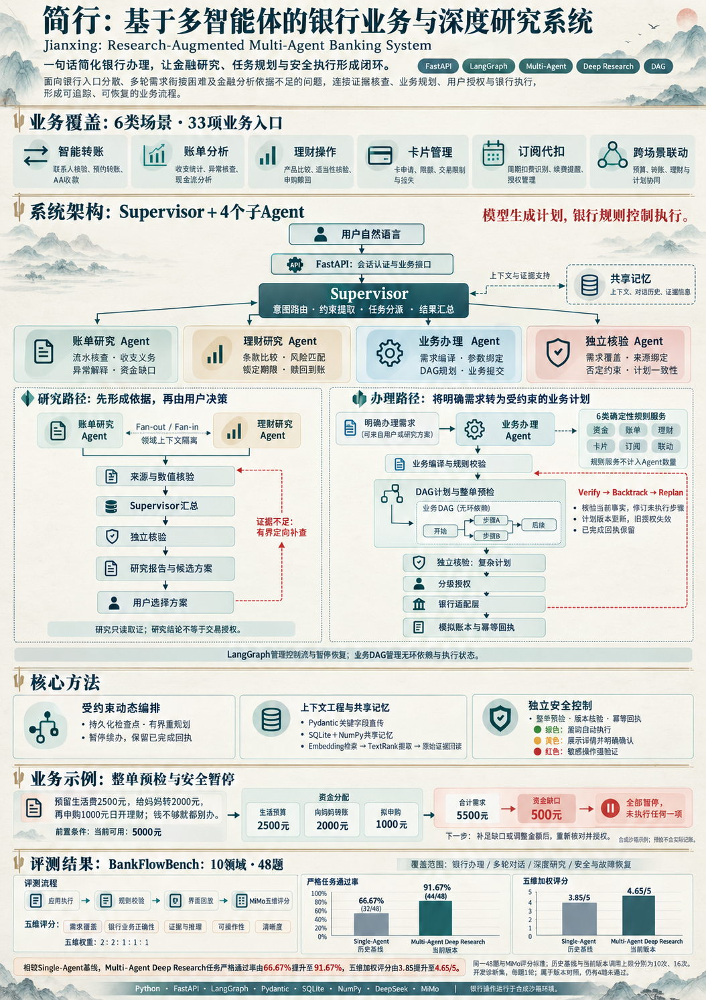

# 简行 · 展示素材

此仓库仅保存项目海报与7张产品界面截图，供项目介绍页加载。**不包含应用源码、密钥、账户数据库或评测原始轨迹。**

全部界面资金、产品、用户和操作均为合成沙箱数据，不产生真实银行扣款。截图通过实际本地UI与API生成；它们属于可复现演示模式，不代表业务模型的评测分数。

## 项目海报

## 产品界面
- [工作台](assets/screenshots/01-workspace.png)
- [计划、资金预检与DAG](assets/screenshots/02-plan-and-funding.png)
- [强验证与回执](assets/screenshots/03-verification.png)
- [账单分析](assets/screenshots/04-bill-analysis.png)
- [Deep Research](assets/screenshots/05-deep-research.png)
- [订阅与代扣](assets/screenshots/06-subscription-management.png)
- [卡片管理](assets/screenshots/07-card-management.png)

项目说明通过维护者提供的介绍页链接访问。源码单独保存在私有仓库，未提供开源授权。
